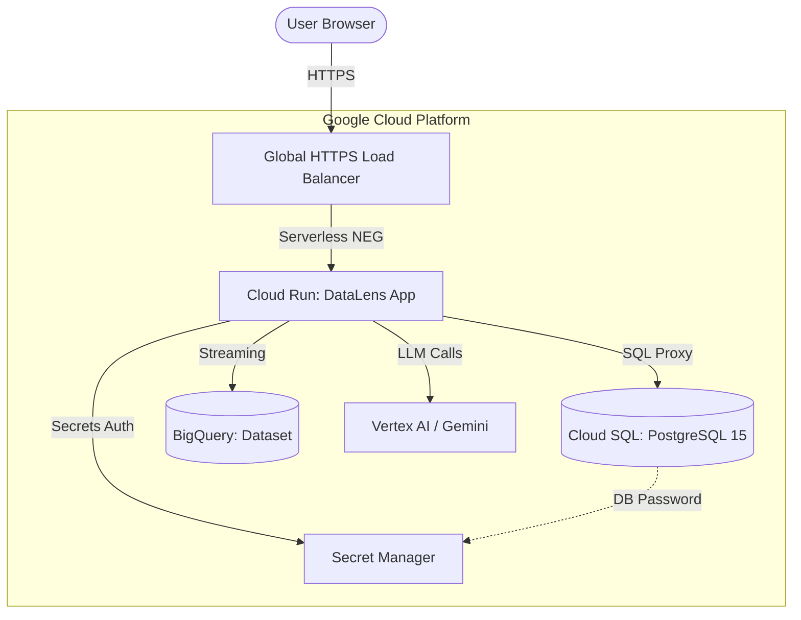

<div align="center">

# 🔍 DataLens AI

### AI-Powered Data Analytics Platform

**Upload. Clean. Visualize. Chat with your data — all in one premium app.**

[](https://react.dev)
[](https://www.typescriptlang.org)
[](https://vitejs.dev)
[](https://ai.google.dev)
[](LICENSE)

</div>

---

## 🌟 What is DataLens AI?

DataLens AI is a **premium, browser-based data analytics suite** that turns raw CSV/Excel files into actionable insights in seconds. With AI-powered cleaning, smart chart recommendations, natural language querying, and pixel-perfect PDF export — it's everything a data analyst needs in one sleek interface.

No Python. No Jupyter. No setup. Just upload and explore.

---

## ✨ Feature Highlights

### 📁 Smart Data Ingestion
- Supports **CSV, Excel (.xlsx/.xls), JSON, and TSV** formats
- High-performance chunk-based parsing with **real-time progress bar and ETA** for files up to 500,000 rows
- Auto-detects column types: `number`, `text`, `date`
- Auto-configurable CSV delimiters (comma, tab, semicolon, pipe)

### 🤖 AI-Powered Features (Gemini)
- **AI Chat** — Ask natural language questions about your dataset ("What is the average revenue by region?")
- **Auto-Analyst** — One-click full analysis: cleaning → statistics → insights → charts → report
- **EDA Report** — Auto-generated exploratory data analysis with AI written insights
- **Smart Chart Recommendations** — AI analyzes your data and recommends the most relevant chart types automatically

### 🧹 Data Cleaning
- Drop null rows / fill with mean, median, mode, or custom value
- Remove duplicate rows
- Convert column data types (text ↔ number ↔ date)
- Drop unwanted columns
- Full **undo/redo history** for every cleaning operation

### 📊 Smart Visualizations
- **AI-recommended charts** — only renders charts relevant to your data (not all 6 at once)
- **Chart Picker Bar** — pill-style toggles to add/remove charts; max 4 active at a time to prevent lag
- Supported chart types: **Bar, Area, Line, Pie, Scatter Plot, Histogram**
- Full-screen **Zoom Mode** with interactive Brush slider for every chart type including Histogram
- **PNG & SVG download** for every chart
- Sampled view mode for large datasets

### 📈 Statistics & EDA
- Per-column statistics: mean, median, std dev, min/max, nulls, unique values
- Distribution preview per column
- Correlation insights
- AI-generated written insights for the entire dataset

### 🗂️ Dashboard Builder
- Drag-and-drop widget canvas (powered by `react-grid-layout`)
- Widget types: **KPI cards, Line charts, Bar charts, Tables, Markdown text**
- Dashboards auto-saved per dataset to localStorage
- Print/PDF export of entire dashboard

### 📄 PDF Export
- Multi-page executive PDF reports via `jsPDF` + `html2canvas`
- Auto-avoiding page breaks — charts and titles never split mid-page
- Dynamic layout budgeting — compresses chart heights to fit on one page before forcing breaks
- Auto-generated Table of Contents with page numbers

### 🔐 Authentication & Onboarding
- Email/password registration and login
- Google OAuth social login
- Multi-step onboarding flow for new users
- Persistent sessions via IndexedDB

---

## 🛠️ Technology Stack

| Layer | Technology |
|---|---|
| **Frontend Core** | React 19, TypeScript 5, Vite 5 |
| **Styling** | Vanilla CSS with CSS variables, Glassmorphism design system |
| **Charts** | Recharts (fully customized — custom tooltips, gradients, animations) |
| **Data Parsing** | PapaParse (CSV), XLSX (Excel), custom JSON/TSV parser |
| **PDF Export** | jsPDF + html2canvas (high-DPI, dynamic layout) |
| **AI / LLM** | Google Gemini API via `@google/genai` SDK |
| **Dashboard** | react-grid-layout (drag-and-drop canvas) |
| **Storage** | IndexedDB (via `idb`) for session persistence |
| **Icons** | Lucide React |

---

## 🚀 Getting Started

### Prerequisites
- **Node.js** v18+
- **npm** v9+
- A **Google Gemini API key** (free at [aistudio.google.com](https://aistudio.google.com))

### Setup

1. **Clone the repository:**
   ```bash
   git clone https://github.com/MD-NAVED/DataLens-AI.git
   cd DataLens-AI
   ```

2. **Install dependencies:**
   ```bash
   npm install
   ```

3. **Configure environment:**
   Create a `.env` file in the root directory:
   ```env
   VITE_GEMINI_API_KEY=your_gemini_api_key_here
   ```

4. **Start development server:**
   ```bash
   npm run dev
   ```
   Open **[http://localhost:3001](http://localhost:3001)** in your browser.

5. **Production build:**
   ```bash
   npm run build
   ```

---

## 📸 App Walkthrough

| Step | What you get |
|---|---|
| **1. Upload** | Drag & drop CSV/Excel — parsed instantly with progress bar |
| **2. Preview** | Browse data table with search, filter, and column type badges |
| **3. Clean** | One-click AI cleaning or manual operations with full undo history |
| **4. Statistics** | Per-column stats with AI written insights |
| **5. Visualize** | Smart chart picker with AI-recommended charts, zoom, download |
| **6. EDA Report** | Full exploratory analysis with AI commentary |
| **7. AI Chat** | Natural language Q&A on your dataset |
| **8. Dashboard** | Build a custom drag-and-drop KPI dashboard |
| **9. Export** | Download PDF, PNG, SVG, CSV, or Excel |

---

## 🏗️ Enterprise Architecture (GCP)

DataLens AI is designed to scale from local CSV analysis to an enterprise cloud analytics platform. Below is the serverless GCP deployment blueprint:



| Component | Role |
|---|---|
| **Cloud Run** | Hosts the Dockerized app, auto-scales 0 → 1000+ instances |
| **Secret Manager** | Stores API keys, JWT secrets, DB passwords securely |
| **Cloud SQL** | Managed PostgreSQL for user accounts and session data |
| **BigQuery** | High-volume dataset analytics warehouse |
| **Vertex AI** | Private, secure access to Gemini Pro/Ultra models |
| **Terraform** | Full Infrastructure-as-Code for repeatable deployments |

---

## 📄 License

This project is licensed under the **MIT License** — see the [LICENSE](LICENSE) file for details.

---

<div align="center">

Made with ❤️ using React, TypeScript & Google Gemini AI

⭐ Star this repo if you find it useful!

</div>
