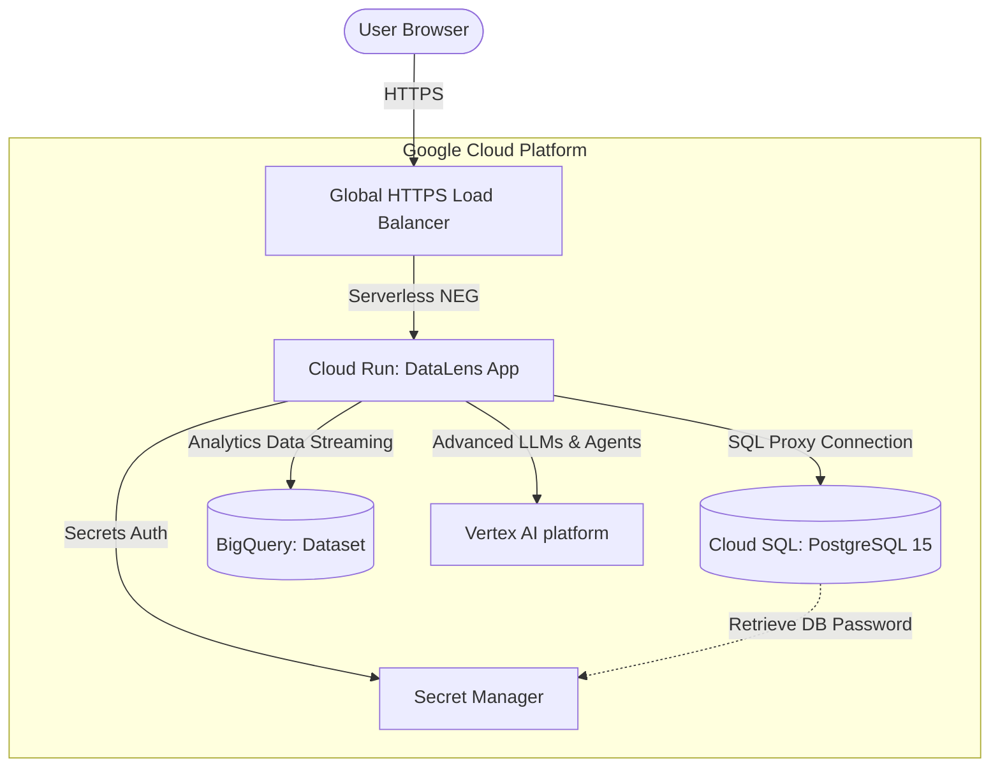

# DataLens AI 🔍📊

DataLens AI is a premium, state-of-the-art data cleaning, insight generation, and executive PDF reporting suite. Powered by the **Google Gemini API**, it enables users to drop raw files (CSV, Excel), clean anomalies in one-click, auto-generate analytical insights, render responsive charts, and download beautiful multi-page PDF executive summaries.

---

## ✨ Key Features

- **🪄 One-Click Auto-Pilot**: Automates null-value dropping, duplicate elimination, statistical calculation, and AI insight generation instantly.
- **📈 Advanced Aggregated Visualization**: Smart data handling prevents cluttered raw-row plots. Automatically groups categorical fields (e.g. Genre, Subscription Type) by mean metrics and renders numeric-to-numeric variables (e.g. Rating vs. Watch Time) as beautiful Scatter Plots.
- **📄 Pixel-Perfect PDF Export**: Powered by a custom `html2canvas` and `jsPDF` pipeline.
  - **Auto-Avoiding Breaks**: Visualizations, titles, and legends are guaranteed to stay together without breaking mid-page.
  - **Dynamic Layout Budgeting**: Automatically scales down/compresses margins and chart heights (`360px` to `220px`) to fit charts on a single page before forcing page breaks.
  - **Dynamic Pagination**: Auto-generates `"Page X of Y"` footers and aligns interactive Table of Contents anchors dynamically.
  - **Anti-Overlap X-Axis**: Dense tick labels automatically tilt (`-30°`) and adjust spacing dynamically.
- **💎 Premium Dark Theme**: A gorgeous, glassmorphism-based UI featuring Outfit/Inter typography, harmonious Indigo/Cyan gradients, and fluid micro-animations.
- **📂 High Performance Parsing**: Utilizes `PapaParse` and `xlsx` chunk-based loading with real-time UI progress/ETA indicators for files up to 500,000 rows.

---

## 🚀 Run Locally

### **Prerequisites**
- **Node.js** (v18+)
- **npm** (v9+)

### **Setup Guide**

1. **Clone the repository:**
   ```bash
   git clone https://github.com/MD-NAVED/DataLens-AI.git
   cd DataLens-AI
   ```

2. **Install dependencies:**
   ```bash
   npm install
   ```

3. **Configure the Environment:**
   Create a `.env.local` or `.env` file in the root directory and append your API credential:
   ```env
   VITE_GEMINI_API_KEY=your_gemini_api_key_here
   ```

4. **Launch Development Server:**
   ```bash
   npm run dev
   ```
   Open **[http://localhost:3000](http://localhost:3000)** in your browser.

5. **Production Build:**
   Validate production correctness or build the bundle using:
   ```bash
   npm run build
   ```

---

## 🛠️ Technology Stack

- **Frontend Core**: React 19, TypeScript, Vite
- **Styling & UI**: TailwindCSS v4, Lucide React, Framer Motion, HSL tailored variables
- **Data Engineering**: PapaParse (CSV chunk parser), XLSX (Excel parser)
- **Charts Engine**: Recharts (fully customized responsive Tooltips, Scatters, and Bars)
- **PDF Engine**: jsPDF, html2canvas (configured with high-DPI scaling and dynamic layout checkers)
- **AI Core**: `@google/genai` (Google Gemini SDK)

---

## 🌐 Enterprise Production Architecture (GCP)

DataLens AI is designed to scale from local CSV file analysis to an enterprise-grade cloud analytics platform. Below is the blueprint of the serverless topology designed to deploy this platform on **Google Cloud Platform (GCP)**.



### ⚡ Architecture Breakdown
* **Cloud Run (Serverless Compute)**: Hosts the Dockerized DataLens AI application, auto-scaling dynamically from 0 to 1000+ instances.
* **Secret Manager**: Securely stores database passwords, API credentials, and JWT secrets, keeping them out of code repositories.
* **Cloud SQL (PostgreSQL 15)**: Managed relational database instance storing persistent client metrics and user records.
* **BigQuery**: Large-scale dataset analytics warehouse, allowing streaming queries of high-volume data.
* **Vertex AI Platform**: Direct integration to advanced LLMs (Gemini Pro/Ultra) via secure, private interior GCP networking.
* **Infrastructure as Code (IaC)**: Deploy and manage this entire infrastructure using **Terraform** blueprint configurations.

